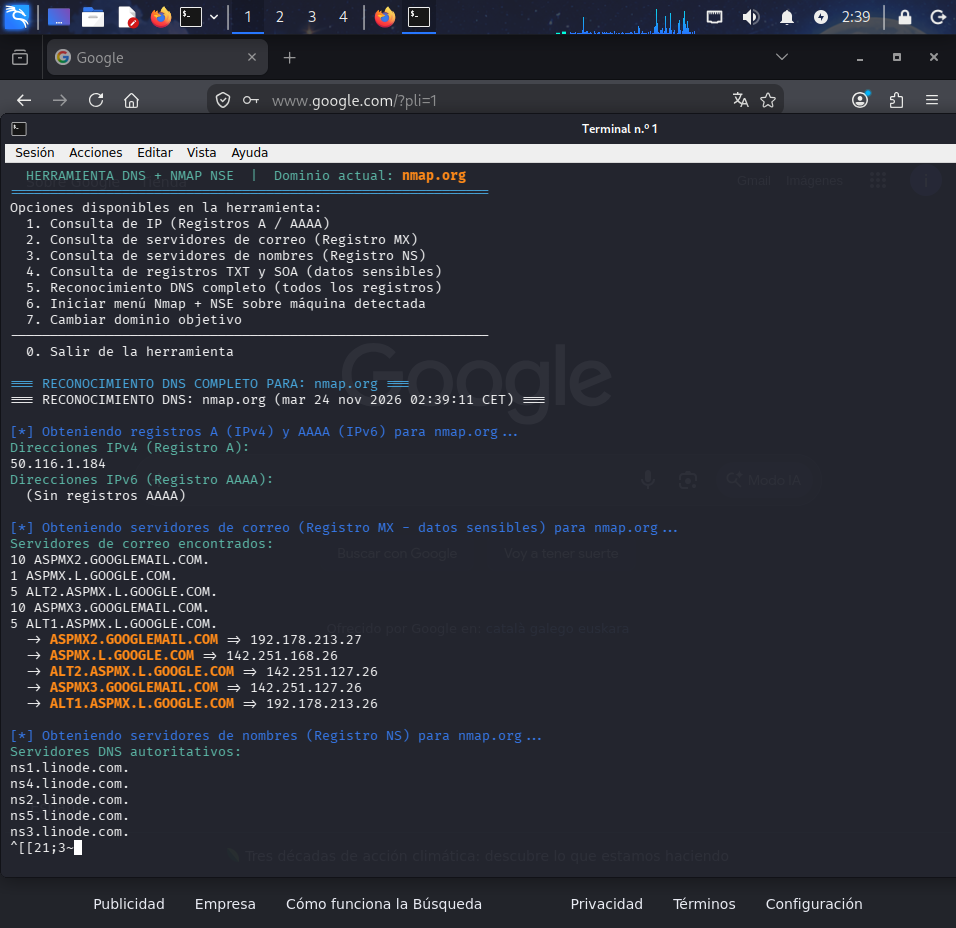
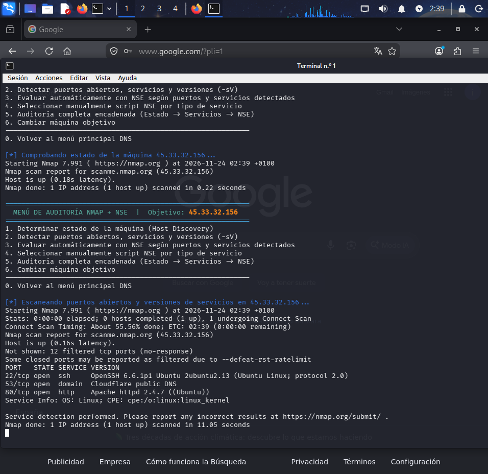
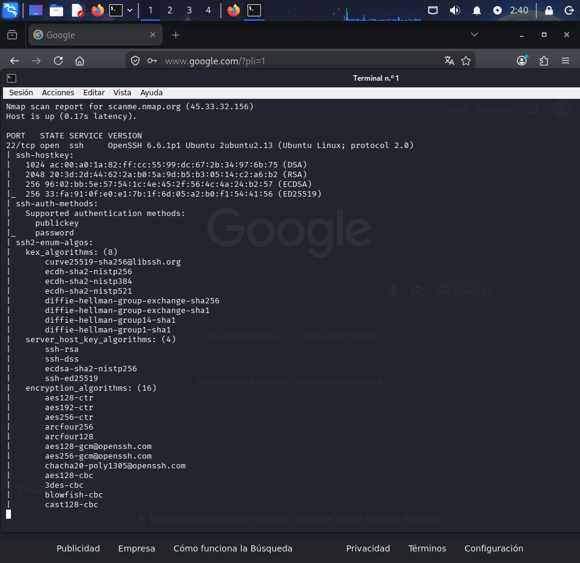
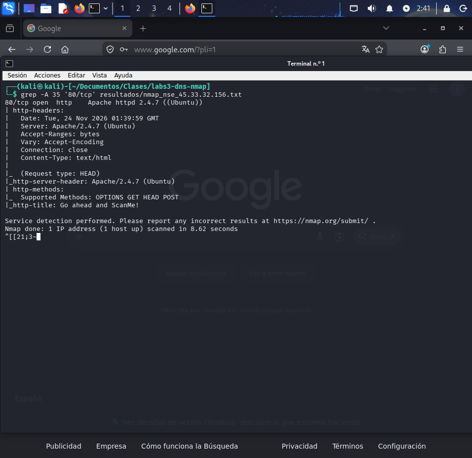

# LABS 3 - 2311: Herramienta Bash de Reconocimiento DNS y Auditoría Nmap + NSE

Aplicación en **Bash** desarrollada en **Kali Linux** que integra reconocimiento DNS sobre un dominio objetivo y una fase posterior de evaluación activa mediante **Nmap** y scripts **NSE** (*Nmap Scripting Engine*) seleccionados automáticamente según el puerto y el servicio detectado.

---

## Objetivo del laboratorio

1. Obtener información **DNS** de un dominio objetivo (`A`, `AAAA`, `MX`, `NS`, `TXT`, `SOA`) para localizar máquinas e infraestructura con posible información sensible (servidores de correo, servidores de nombres, registros SPF/DMARC, direcciones IP).
2. A partir de las máquinas obtenidas, iniciar un **menú interactivo con Nmap** para:
   - Determinar el **estado de la máquina** (*Host Discovery*).
   - Identificar los **puertos abiertos, servicios y versiones** en ejecución (`-sV`).
   - Ejecutar automáticamente el **script NSE correspondiente** a cada servicio y puerto detectado (HTTP/HTTPS, SSH, SMTP, FTP, DNS, SMB, MySQL, RDP, etc.).

---

## Requisitos

- Kali Linux (o cualquier distribución Linux con `bash`).
- Herramientas necesarias:
  - `dig` (paquete `dnsutils`)
  - `nmap` (con librería de scripts NSE)
  - `git`

```bash
sudo apt update && sudo apt install -y dnsutils nmap git
```

---

## Instalación y uso

```bash
git clone https://github.com/puenteuropaismael-max/labs3-dns-nmap.git
cd labs3-dns-nmap
chmod +x dns_nmap_audit.sh
./dns_nmap_audit.sh
```

### Flujo de uso

1. Introduce el **dominio objetivo** (por ejemplo `nmap.org` o `scanme.nmap.org`).
2. En el **menú principal DNS**, ejecuta las consultas individuales (`1`-`4`) o el **reconocimiento DNS completo** (`5`). Las IPs detectadas quedan almacenadas automáticamente.
3. Selecciona la opción **`6. Iniciar menú Nmap + NSE sobre máquina detectada`** y elige la máquina objetivo.
4. Dentro del submenú Nmap:
   - `1`: Comprobar estado de la máquina (`Host is up`).
   - `2`: Detectar puertos abiertos y versiones de servicios (`-sV`).
   - `3`: Evaluar automáticamente con los **scripts NSE** adecuados para cada puerto/servicio abierto.
   - `4`: Lanzar manualmente un perfil NSE específico (Web, SSH, SMTP, FTP, DNS, SMB o `vuln`).
   - `5`: Ejecutar la auditoría completa encadenada y guardar todos los resultados en `resultados/`.

---

## Estructura del repositorio

```text
labs3-dns-nmap/
├── dns_nmap_audit.sh      # Script principal en Bash (DNS + Nmap + NSE)
├── README.md              # Documentación del proyecto
├── capturas/              # Capturas de pantalla de pruebas en Kali Linux
└── resultados/            # Informes generados durante las pruebas
```

---

## Evidencias de ejecución en Kali Linux

### 1. Reconocimiento DNS completo (`nmap.org`)


### 2. Estado de la máquina y detección de puertos/servicios (`scanme.nmap.org`)


### 3. Evaluación automática con scripts NSE (SSH y HTTP)


